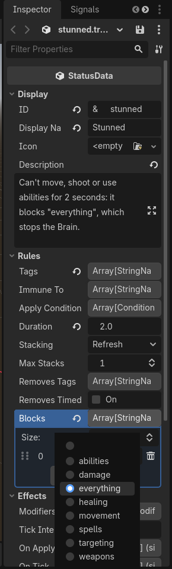

.. _doc_editor_warnings_for_names:

Editor warnings for names
=========================

Stats, events, tags and pools are typed as text, so a typo such as ``move_sped`` or ``took_damgae`` would otherwise do nothing, with no error. :ref:`NameCheck<class_NameCheck>` reads the project for the names that exist:

- **Stats:** the ones components declare in ``_stats()``, the ones listed in a :ref:`ComponentManager<class_ComponentManager>`'s Stats in saved scenes, and ``max_<pool>`` and ``<pool>_regen`` for each :ref:`Pool<class_Pool>` in a saved scene. Any ``resist_<type>`` or ``bonus_<type>`` is allowed, because damage types are open-ended.
- **Events:** the ones scripts send with ``notify()`` or ``send()``.
- **Tags:** the ones saved statuses have.
- **Pools:** the names of the Pools in saved scenes.

Each name in your data is checked against them: the stat of a :ref:`StatModifier<class_StatModifier>`, :ref:`StatCondition<class_StatCondition>`, :ref:`StatAmount<class_StatAmount>` or :ref:`ChanceCondition<class_ChanceCondition>`, a trigger's event, the tags a status is immune to or removes, an ability's costs and Blocked By names, a status's Blocks, and the pool of a :ref:`ChangePoolEffect<class_ChangePoolEffect>`. An unknown one gets a warning with the closest match, such as "Did you mean 'move_speed'?".

The warnings show in two places. :ref:`Statuses<class_Statuses>`, :ref:`Grants<class_Grants>`, :ref:`Abilities<class_Abilities>`, :ref:`Trigger<class_Trigger>`, :ref:`Hitscan<class_Hitscan>` and :ref:`MeleeSweep<class_MeleeSweep>` list them as node warnings in the Scene dock. The Character System Warnings add-on, enabled in Project Settings > Plugins, shows them above the Inspector for the resource being edited. Your own components can do the same by returning ``NameCheck.problems_in(...)`` from ``_warnings()``.

.. _doc_name_lists:

Names are picked from a list
----------------------------

The same names fill the Inspector. Every field that holds one opens a list of what the project already has: a modifier's Stat, a trigger's Event, a status's Tags, Immune To, Removes Tags and Blocks, the keys of an ability's Costs, every Blocked By, the Pool of an effect, condition or amount, the events in an :ref:`Animator<class_Animator>`'s Animations, and the Tags of a hit, a :ref:`Hurtbox<class_Hurtbox>` or a :ref:`HitCondition<class_HitCondition>`. The list is a suggestion, not a limit: typing a name that isn't in it works, which is how a new tag or a new thing to block comes into being. A :ref:`Pool<class_Pool>`'s own Pool field has no list, because that is where a pool's name is made up.

   What Stunned can block, in Godot 4.8 beta 4. ``spells`` is in the list because an example ability answers to it.

Your own scripts get the lists by naming the field as the built-in ones do. In a script that starts with ``@tool`` and extends :ref:`Component<class_Component>`, :ref:`Effect<class_Effect>`, :ref:`Condition<class_Condition>`, :ref:`Amount<class_Amount>` or :ref:`MotorNode<class_MotorNode>`, an exported ``stat``, ``bonus_stat``, ``pool``, ``event``, ``tag``, ``tags``, ``blocks`` or ``blocked_by`` shows the matching list:

.. code-block:: gdscript

    @tool  # Without this the field is plain text.
    class_name SiphonEffect
    extends AmountEffect

    @export var pool: StringName = &"mana"  # Lists the project's pools.

The data classes get this from one base class, :ref:`DataResource<class_DataResource>`: extend it for a kind of data of your own that isn't an effect, a condition or an amount. A script that extends something else calls ``NameCheck.suggest(self, property)`` from its own ``_validate_property()``, as ``DataResource``, ``Component`` and ``MotorNode`` do. If it overrides ``_validate_property()`` for another reason, it calls ``super(property)`` there, because Godot only runs the most derived one.

.. source-file:: ../../character_system/core/name_check.gd

It only sees names written in code and saved files, plus the events the :ref:`CharacterMotor<class_CharacterMotor>` sends for each movement mode and move with a ``class_name``, such as ``walk_mode_entered``. A name built at runtime, such as an event sent with a variable, isn't seen, so a trigger for it is reported even though it works. The same goes for a stat added to a manager's Stats from code, or a pool that only exists in a scene you haven't saved yet. Resources saved in their own file are checked when you open them. With the add-on enabled, the project is read again whenever its files change or a resource is saved, so a large project isn't re-read while nothing changes. Without the add-on, it's read again at most every 30 seconds.
